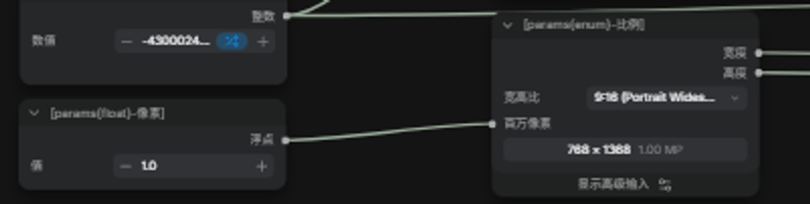
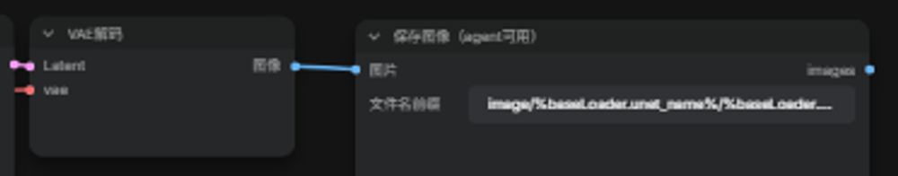
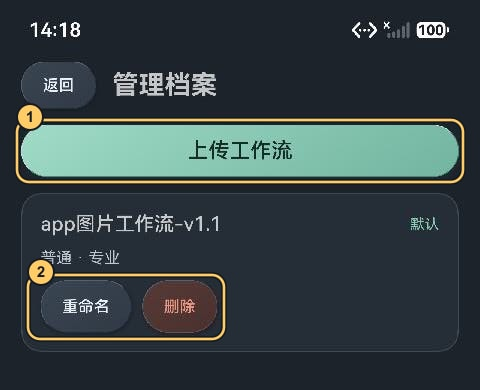

# ComfyUI 工作流适配指南

拿一份在电脑上已经能出图的工作流开始。你只需要给想在手机上调整的参数加个标记，再把工作流导入 App。

通用版 v1.1 示例是 API 格式 JSON，可以对照下文看节点的标题标记、接线和图片输出。拿来出图前，先在 ComfyUI 检查缺失节点，并把模型、CLIP、VAE 和 LoRA 换成电脑上已有的文件。[下载通用版 v1.1 参考工作流](https://github.com/ikeWangXL/comfy-suishen/releases/download/v1.0.0-preview/Comfy-Suishen-Workflow-v1.1.json)

## 先让 App 能出图

1. 在 ComfyUI 里打开工作流。把最终图片接到内置的「保存图像」(`SaveImage`) 或「预览图像」(`PreviewImage`)。例如把 VAE 解码的 `IMAGE` 接到它的 `images`。文本、视频或只有第三方保存节点的工作流，App 会显示不可用。
2. 给提示词单独加一个「多行文本」(`Text (Multiline)`) 节点。把它的**节点标题**改成 `[params{string}-提示词]`，并把它连到真正用于出图的正向提示词输入。
3. 如果还想用「普通模式」，给「分辨率选择器」(`ResolutionSelector`) 的标题加上 `[params{enum}-比例]`。用一个「浮点数」(`Float`) 节点给它的 `megapixels` 供值，并把浮点节点标题改成 `[params{float}-像素]`。把分辨率选择器的宽、高输出接到实际决定画布尺寸的节点上。

下面是这三处在图里的位置。方括号里的整段文字就是要填进节点标题的内容。

```text
[params{string}-提示词] ──────────► 正向提示词输入
[params{float}-像素] ────────────► ResolutionSelector 的 megapixels
[params{enum}-比例]（ResolutionSelector）── 宽和高 ──► 画布尺寸

最终 IMAGE ─────────────────────► SaveImage 或 PreviewImage
```

**V1.1 工作流实拍。** 左下角的「像素」浮点节点连到右边分辨率选择器的「百万像素」。右边节点的标题是 `[params{enum}-比例]`，它的「宽度」和「高度」继续接到画布。



看图片输出时，认准这条蓝线。它把「VAE 解码」的「图像」输出接到「保存图像」的「图片」输入。



普通模式需要**提示词、比例、像素各有一个**。如果你用固定宽高，只加提示词标记也可以用专业模式。给负向输入加标记时，可取名 `[params{string}-反向描述]`。如果写成「负向提示词」，Server 也会把它识别成首页提示词，导致两个提示词位置冲突。

## 把想调的参数放到手机上

标题格式是 `[params{类型}-名称]`，括号、花括号和短横线都用半角字符。名称会显示在 App 里，同一份工作流里每个名称只用一次。节点其余设置照常填写。

| 想在 App 里改什么 | 标记示例 | 标记加在哪里 |
| --- | --- | --- |
| 步数 | `[params{int}-步数]` | 用一个 `Int` 节点接到采样器的 `steps`，标题加在 `Int` 上 |
| CFG 或去噪 | `[params{float}-CFG]`、`[params{float}-去噪]` | 各用一个 `Float` 节点接到 `cfg` 和 `denoise` |
| 生图模型 | `[params{model}-生图模型]` | 「加载扩散模型」(`UNETLoader`) 或「加载检查点」(`CheckpointLoaderSimple`) |
| 独立 CLIP、VAE | `[params{clip}-CLIP模型]`、`[params{vae}-VAE模型]` | 分别加在 `CLIPLoader` 和 `VAELoader` 上 |
| 其他文本、开关、下拉选项 | `[params{string}-反向描述]`、`[params{boolean}-启用细节]`、`[params{enum}-风格]` | 选一个对应类型的输入，确认这个节点里只有一个同类型候选 |

如果把「步数」直接标在 `KSampler` 上，Server 会同时找到整数输入 `seed` 和 `steps`。遇到「绑定歧义」，就用独立的 `Int`、`Float`、`Boolean` 或文本节点给目标输入供值，把标记放到单值节点上。同一个输入只标一次。

模型下拉显示的是当前 ComfyUI 给那个加载器提供的选项。用一个检查点同时提供模型、CLIP 和 VAE 时，一个「生图模型」选择就够了。想分别选择 CLIP 和 VAE 时，在图里接好各自的加载节点。

### 种子和 LoRA

- **种子**。App 只找第一个标准 `KSampler` 的 `seed`。如果有多个节点要跟随 App 的种子，用一个 `Int` 同时接到这个 `seed` 和其他节点的种子输入。各自填写或另接种子节点的地方，不会跟随 App 填的种子。只需共享种子时，无需额外给种子节点加参数标记。
- **LoRA**。内置的「加载 LoRA（模型和 CLIP）」(`LoraLoader`) 和「加载 LoRA」(`LoraLoaderModelOnly`) 会自动出现在专业参数里。请在节点里选好 LoRA 文件。App 的强度调整作用于对应节点的模型强度，开启时保留该节点原来的 CLIP 强度或连线。

### 想让工作流支持 CLIP 扩写

只用原提示词或 App 的 LLM 扩写，可以跳过这一节。要在图里做 CLIP 扩写，用 `Generate Text`（`TextGenerateV2`）生成扩写文本，再通过 `If/Else Switch`（`ComfySwitchNode`）切换原文和扩写结果。

```text
原提示词 ────► Generate Text 的 prompt
原提示词 ────► If/Else Switch 的 on_false
扩写结果 ────► If/Else Switch 的 on_true
[params{boolean}-ai扩写] ─► If/Else Switch 的 switch
If/Else Switch 输出 ──────► CLIPTextEncode 的 text
```

把这个 `CLIPTextEncode` 用在真正参与出图的正向分支上。如果想在 App 修改系统提示词，再用独立文本节点接到 `Generate Text` 的 `system_prompt`，标题写 `[params{string}-ai扩写提示词]`。扩写分支接不齐时，App 会提示跳过，继续按原提示词出图。ComfyUI 还需要有 `PreviewAny`，Server 用它读取扩写结果。

## 导出、检查

1. 先在 ComfyUI 里运行一张，确认图片能出、模型和自定义节点都装齐。
2. 用 ComfyUI 的 **「导出（API 格式）」** 保存 JSON。平时编辑画布用的工作流 JSON 是另一种格式，App 会提示重新导出。
3. 在 App 打开 **设置 → 工作流档案 → 管理档案 → 上传工作流**。选文件，点检查，核对参数和可用模式，再保存档案。
4. 回到生成页选这份档案，先出一张。确认提示词和分辨率生效，再试模型下拉、种子或 LoRA。



如果普通模式没出现，先看是否少了提示词、比例或像素标记。如果提示缺少图片输出，先检查 `SaveImage` 或 `PreviewImage` 的 `images` 是否真的接到了最终图。Server 按当前 ComfyUI 报出的输入类型和选项检查，自定义节点装齐后需要重新检查。

首次打开档案时，App 使用这份 JSON 里的参数。软盘保存的是 App 的档案偏好。生成时 Server 会复制工作流再注入本次参数，确认保存偏好或出图都不会覆盖源 JSON。
