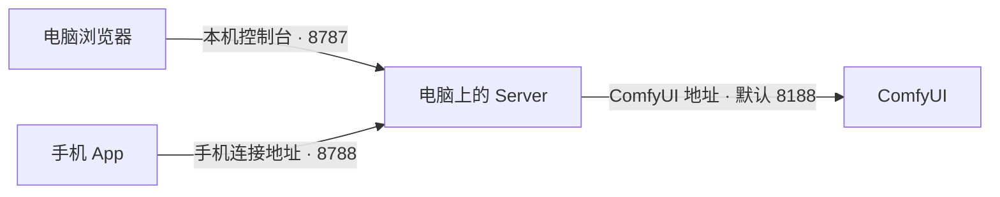

# Comfy 随身 Server 操作手册

Server 装在运行 ComfyUI 的 Windows 电脑上。手机把任务交给 Server，ComfyUI 出图，Server 再把图片存进你选的文件夹。

## 安装前

- **Windows 10 或 11（64 位）**，使用系统自带的 Windows PowerShell 5.1 运行启动脚本。
- **Node.js 26 或更高版本**。启动脚本会用 `npm` 安装或更新依赖，电脑需要可以访问 npm 软件包仓库。[Node.js 下载](https://nodejs.org/zh-cn/download)
- **能正常出图的 ComfyUI**。先在 ComfyUI 里试跑要用的工作流，确认模型和自定义节点都已装好。用于导入的工作流请用 API 格式 JSON。[工作流适配指南](ComfyUI%20工作流适配指南.md)
- **可写的存图目录和局域网**。为图库预留空间。电脑可以插网线，手机连同一个路由器的 Wi‑Fi 即可。

## 第一次启动

1. 在 GitHub 仓库页面点 **Code → Download ZIP**。把压缩包解压到有写入权限的目录，进入 `comfy_server` 文件夹，双击 `install-start.cmd`，等窗口提示「server 就绪」。
2. 如果脚本提示缺少 Node.js，选择 Windows 安装程序（`.msi`），版本选 26 或更新。装好后回到启动窗口按回车继续。如果仍提示找不到 Node.js，关掉窗口再双击启动脚本。[Node.js 官方下载页](https://nodejs.org/zh-cn/download)
3. 等浏览器打开控制台。如果页面没自动弹出，在这台电脑上打开 `http://127.0.0.1:8787/`。首次登录的用户名和密码都是 `admin`。用手机时，启动窗口也要留着。

## 连上 ComfyUI 和手机

1. 先打开 ComfyUI。电脑控制台的「概览」里看到 ComfyUI **已连接**，就可以继续。否则打开「服务与连接 → ComfyUI 连接」，把 ComfyUI 的地址和端口填进 **Base URL**，点「测试连接」，成功后点「保存配置」。默认地址是 `http://127.0.0.1:8188`，如果你的 ComfyUI 用的是别的端口，就填实际地址。
2. 让手机和电脑连到同一个路由器。在控制台的「概览 → 手机连接地址」点「复制地址」，把完整地址填进 App，比如 `http://192.168.1.20:8788`。用控制台的同一套账号登录。

## 选存图目录，上传工作流

1. 在「图库与档案 → 图库根目录」点「选择目录」或「更改目录」。打开想存图的文件夹，点「选择此目录」，看到 **可写 · 已验证** 就好了。换目录后，新图存到新目录，旧图留在原处。图库只收录 App 生成并入库的图。
2. 在同一页点「上传 API JSON」，选择从 ComfyUI **导出（API 格式）** 的工作流。看完检查结果，选可用模式，再点「保存档案」。平时常用的工作流可以点「设默认」。[ComfyUI 工作流适配指南](ComfyUI%20工作流适配指南.md)

电脑这边配好后，就可以在手机上选档案出图了。[鸿蒙 App 操作手册](鸿蒙%20App%20操作手册.md)

## 控制台每一页能做什么

| 菜单 | 常用操作 |
| --- | --- |
| 概览 | 看 Server 和 ComfyUI 的连接状态、正在排队的任务，复制手机连接地址，设置 Windows 登录后启动 Server。 |
| 服务与连接 | 测试或修改 ComfyUI 地址，修改登录账号和密码，配置自定义 LLM。 |
| 图库与档案 | 选择存图目录，上传并检查工作流，把常用档案设为默认。 |
| 备份与诊断 | 创建或恢复备份，查看诊断摘要和运行日志。 |

## 日常管理

- **启动和退出。** 以后可以双击 `install-start.cmd` 启动。也可以在「概览」打开「Windows 登录后启动服务」。这个开关只启动 Server，ComfyUI 还是按你原来的方式启动。手动运行时，在启动窗口按 `Ctrl+C` 可以停止 Server。
- **改账号或密码。** 到「服务与连接 → Owner 账号」，输入当前密码和要修改的内容，再点「保存账号」。保存后，手机和控制台都要重新登录。
- **配置 LLM 扩写。** 需要时到「服务与连接 → 自定义 LLM」，开启扩写，填供应商的接口地址、模型名和 API Key，再保存。
- **备份和恢复。** 到「备份与诊断」点「创建备份」。设置、工作流和档案偏好会存到 Server 文件夹里的 `data\workflow\backup`。想备份图片，就另外复制图库文件夹。要恢复时，从「选择已有备份」选一份，点「校验并恢复」。确认后会替换当前的设置和档案。

## 更新 Server

1. 先结束正在运行的任务，再停止 Server。备份 `%LOCALAPPDATA%\ComfyAppServer`（设置和数据库）及 `comfy_server\data`（工作流和档案备份）。如果要备份图片，再复制图库文件夹。
2. 把新版本的程序文件覆盖到原 `comfy_server` 文件夹，保留其中的 `data`。再用同一个 Windows 账号运行 `install-start.cmd`，确认控制台里能看到原来的工作流和图库目录。

## 连不上时先看这里

| 看到什么 | 怎么查 |
| --- | --- |
| 电脑打不开控制台 | 看 Server 启动窗口是否还在。若提示端口被占用，先确认 Server 是否已经开着，避免重复启动。 |
| 启动窗口提示依赖安装失败 | 检查电脑能否联网，并在命令提示符里运行 `node -v` 和 `npm -v`，确认 Windows 找得到 Node.js 和 npm。 |
| 控制台能打开，ComfyUI 显示未连接 | 确认 ComfyUI 已启动，再核对 Base URL 的端口，点「测试连接」看结果。 |
| 手机连不上，尤其是电脑重启后 | 确认 Server 已启动，从「手机连接地址」重新复制当前地址。还是不通，就检查手机和电脑是否在同一局域网，以及 Windows 防火墙是否允许 Server 的 `8788` 端口在专用网络上接收连接。 |
| 工作流上传后不能生成 | 看「工作流检查结果」里的提示，核对缺少的节点、模型或图片输出，再重新导出 API 格式并上传。 |
