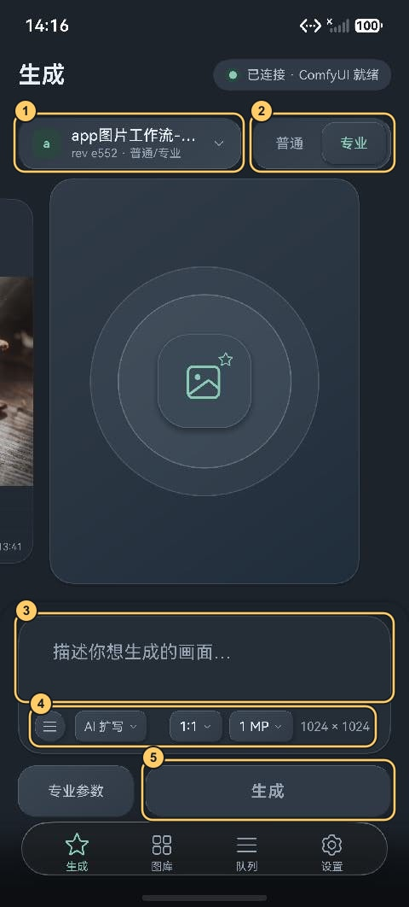
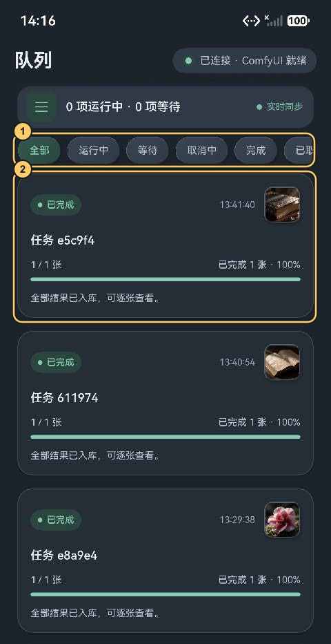
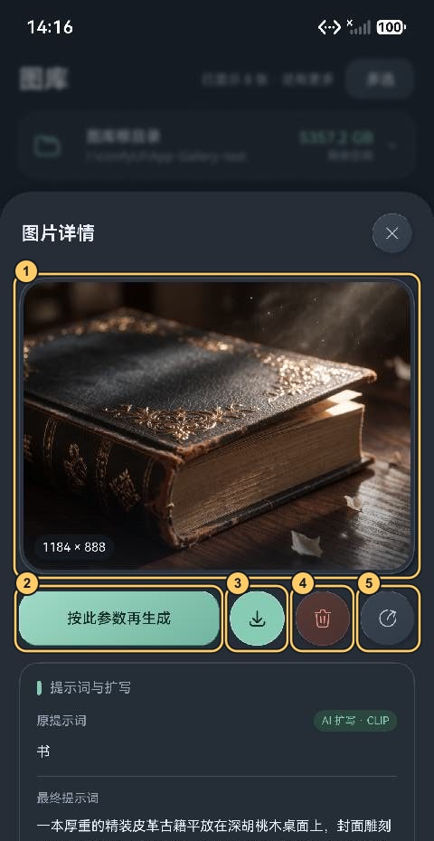
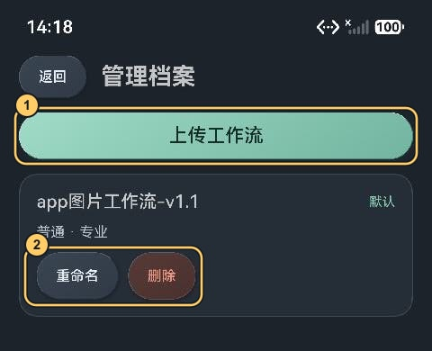

# 鸿蒙 App 操作手册

手机用来下任务、看进度和翻图库，实际出图在电脑上完成。还没装好 App，可以先看[鸿蒙 App 安装说明](鸿蒙%20App%20安装说明.md)。

## 第一次连接

1. 在 Windows 电脑上启动 ComfyUI 和配套的 Server，手机和电脑连到同一个路由器。
2. 打开电脑控制台，找到「手机连接地址」。把完整地址填进 App 登录页，例如 `http://192.168.1.20:8788`。登录用的是 Server 账号和密码。
3. 在 App 的「设置」里确认 API 状态正常、ComfyUI 已连接。如果还没有图库目录，到「图库根目录 → 更改根目录」选一个电脑上的文件夹。

## 生成一张图

1. **选工作流。** 工作流就是电脑上的出图配置。顶部列表为空时，先去「设置 → 工作流档案 → 管理档案」上传。
2. **选模式。** 第一次用「普通」就够了。「专业」可以改生成次数、种子、保存位置和 LoRA 等，具体能改什么看当前工作流。工作流一次生成多张图时，可以在队列详情或图库查看每张结果。LoRA 强度可以手输负数，每点一次加减按钮改 0.05。底部的圆形重置按钮可恢复工作流默认值，确认后，点旁边的保存图标才会覆盖档案偏好。
3. **写提示词。** 比如「雨后街角的一家旧书店」。
4. **调参数。** 选画面比例和像素档位，右侧会显示预计宽高。点左边的三横线打开提示词历史，搜关键词，再点一条填回输入框。
5. **点生成。** 可以留在这里看进度，也可以切到「队列」。

**AI 扩写怎么选？** 直接用自己写的提示词时，保留「AI 扩写」默认项。选「CLIP 扩写」会走当前工作流里的扩写步骤，然后直接出图。选「LLM 扩写」前要先在设置里配好供应商。App 会先给你看扩写结果，可以直接改文字，也可以改系统提示词后点「重新扩写」。点「确认并生成」才开始出图。

## 队列里看进度

1. 标题栏显示运行中和等待的任务数。下拉刷新，往下翻会自动加载更多任务。点右下角箭头可以回到顶部。
2. 点一条任务看生成用时、提示词和图片。失败时先看卡片上的原因，再点「调整参数」回生成页。取消多张任务时，已经生成的图片会保留。

## 图库里看图、保存和分享

点图库上方的目录卡可以换目录。标题栏显示已加载张数和当前目录的总张数。下拉刷新，往下翻会自动加载更多。想一次删几张，先长按任意图片进入多选，再点图勾选，最后点垃圾桶确认。

1. **点图全屏看。** 双指可以缩放，放大后可以拖动。
2. **按此参数再生成。** 把这张图的参数带回生成页，改好后再点生成。
3. **向下箭头。** 保存原图到手机相册。
4. **垃圾桶。** 确认后会删除电脑上的原图和缩略图。一个任务的图全删完后，队列里的任务记录也会移除。
5. **分享。** 打开系统分享面板。全屏看图时，长按图片也能分享。

## 设置里常用的两项

**管理工作流。** 到「设置 → 工作流档案 → 管理档案」。点 **① 上传工作流**，选 ComfyUI 导出的 API 格式 JSON，检查通过后保存。列表里的 **② 重命名、删除** 用来整理档案，也可以把常用档案设为默认。

工作流需要连接「保存图像」(`SaveImage`) 或「预览图像」(`PreviewImage`)，App 才能接收图片。首次打开档案时，控件使用源文件里的参数。点软盘并确认后，App 会记住当前的档案偏好，电脑上的 JSON 保持原样。

自己改工作流时，App 只会解析一个共享种子。把种子节点接到标准 `KSampler` 的 `seed`，再把它接到其他所有需要种子的节点上。单独填写种子或另接种子节点的地方，用的是工作流自己的值，App 填的种子在这些地方不会生效。

在电脑上替换当前工作流后，生成按钮会变成「刷新档案」。点它加载新参数，输入框里的提示词会保留。有未保存的参数改动时，App 会先请你确认。

分辨率预览使用 ComfyUI 的 `ResolutionSelector`。CLIP 扩写使用「生成文本」(`TextGenerateV2`)、「切换」(`ComfySwitchNode`) 和「CLIP 文本编码」(`CLIPTextEncode`) 组成的分支。扩写分支不完整时，App 会提示需要检查的节点，任务继续出图。

**配置 LLM 扩写。** 到「设置 → 自定义 LLM 扩写」，开启后点「修改配置」。填供应商的 Base URL 和 API 密钥，点「刷新模型」，选好模型再保存。其他参数按供应商的要求填即可。

如果手机连不上电脑，先核对「设置 → 电脑服务」里的 Server 地址，再看电脑上的 Server 是否还在运行。电脑重启后地址变了，就在这里点「切换 Server」。
